<div align="center">

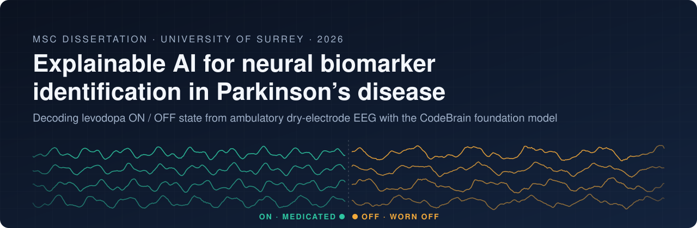

<br>

[](dissertation/Explainable_AI_for_neural_biomarker_identification_in_Parkinsons_disease.pdf)
[](LICENSE)


**[Overview](#overview)** · **[Results](#results)** · **[Method](#method)** · **[Repository layout](#repository-layout)** · **[Running things](#running-things)** · **[Licence](#licence)**

</div>

---

## Overview

Parkinson's disease (PD) is treated with levodopa, which relieves motor symptoms for a limited period after each dose. As the disease advances, patients fluctuate between an **ON** state, in which the medication is working, and an **OFF** state, in which it has worn off. Knowing which state a patient is in, continuously and objectively, would let treatment follow the patient's actual condition.

This MSc dissertation asks whether that information survives at the scalp, in electroencephalography (EEG) recorded with a **dry-electrode headset while patients move freely through everyday tasks**, and which frequencies carry it. It has two stages:

1. **A preprocessing pipeline** that turns raw ambulatory recordings from the Living Lab cohort into a window cache.
2. **A fine-tuning and explainable AI (XAI) study** that adapts the **CodeBrain** EEG foundation model ([Ma et al., arXiv 2506.09110](https://arxiv.org/abs/2506.09110)) to classify medication state, then probes what the model relies on with a band-stop frequency sweep.

The submitted dissertation is in [`dissertation/`](dissertation/).

## Results

<p align="center">
  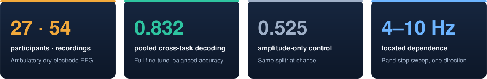
</p>

The main analysis trains one shared model across participants on windows from one kitchen task and tests it on a different kitchen task, so elapsed time never enters the split.

| | |
|---|---|
| **Main analysis** | Pooled cross-task decoding, 27 participants, 54 recordings |
| **Best arm** | Full fine-tune, 0.832 balanced accuracy (95% CI 0.792–0.869), toast-to-tea, duration-matched |
| **Reverse direction** | 0.710 (95% CI 0.667–0.752) |
| **Channel-amplitude control** | 0.525 and 0.535, at chance in both directions |
| **Cross-participant transfer** | Null. Five configurations, none significant |
| **Classical candidate** | Broad 2–6 Hz relative-power increase OFF, 0.629 and 0.620 on two leak-free splits, both p = 0.005 |

Medication state was separable within participants across a change of behavioural task, with accuracy rising with adaptation capacity. The separation did not survive removing the test participant's own recordings from training. No candidate met the certification criterion fixed in advance, so the contribution is a boundary on what ambulatory dry-electrode EEG supports, not a biomarker.

<p align="center">
  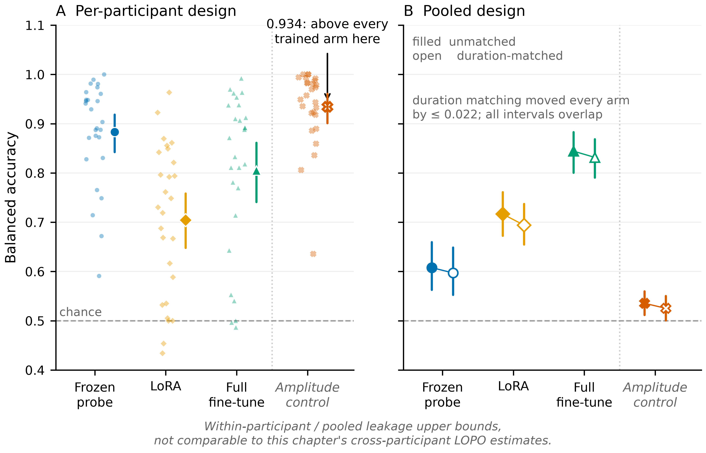
  <br>
  <em><b>Adaptation arms against the amplitude control.</b> Per-participant (left) and pooled (right) task-split designs. Filled markers are unmatched, open markers duration-matched.</em>
</p>

### Where the model is looking

<p align="center">
  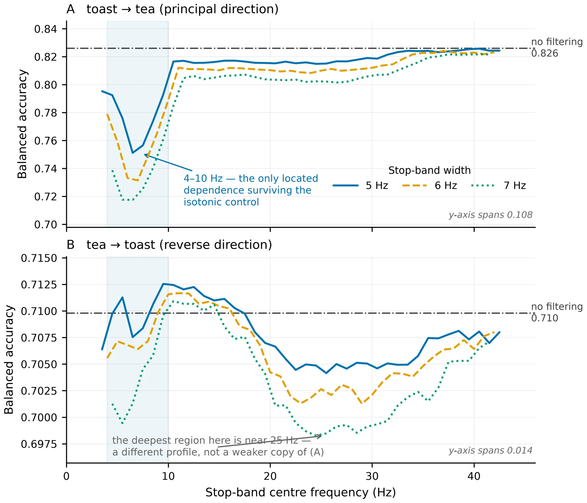
  <br>
  <em><b>Band-stop sweep.</b> Accuracy with one slice of frequencies removed at a time, for 5, 6 and 7 Hz stop-bands. The dip on the left of (A), between 4 and 10 Hz, is where the model was looking: the only located dependence that survives the control for the quantity of power removed. The reverse direction (B) moves far less (note the y-axis spans) and has a different profile, not a weaker copy of (A).</em>
</p>

The cross-participant (leave-one-participant-out, LOPO) arms were run first and returned a null. Their results are kept in full under `codebrain_finetune/results/` alongside the main analysis.

<details>
<summary><b>More result figures</b></summary>
<br>

| | |
|:---:|:---:|
| 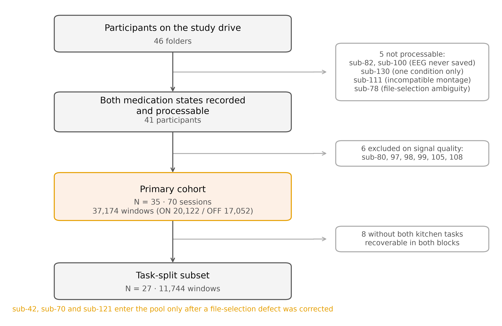<br><em>Cohort flow</em> | 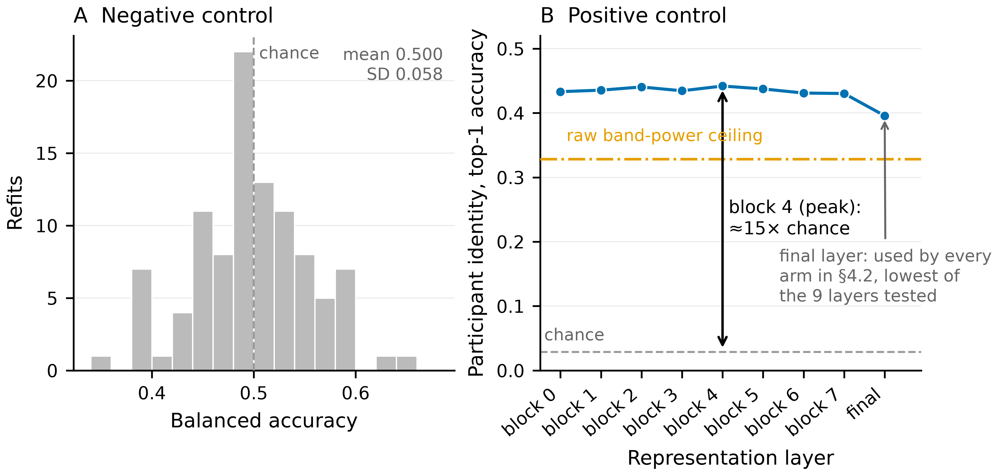<br><em>Controls</em> |
| 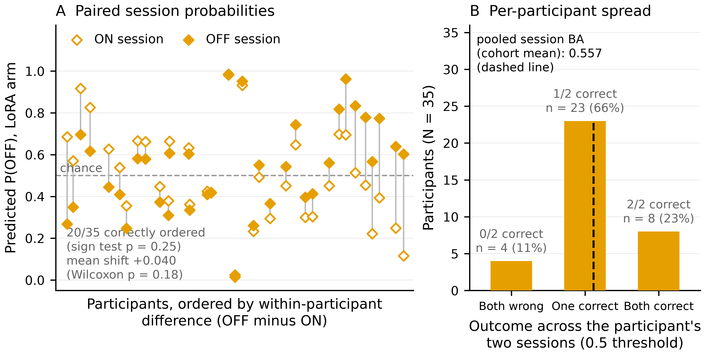<br><em>Paired OFF-probability spread</em> | 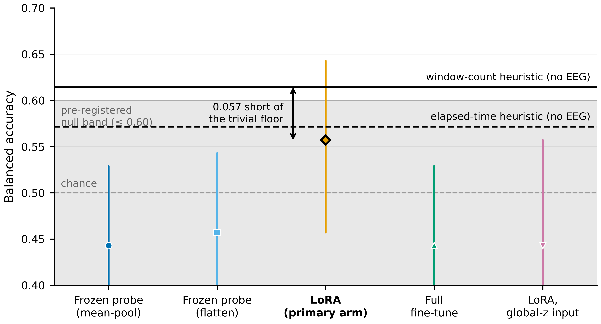<br><em>Trivial-feature floor</em> |
| 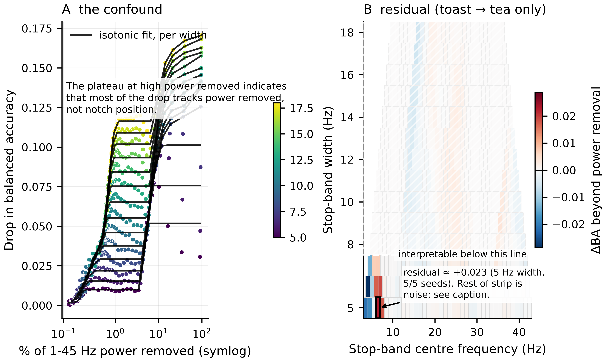<br><em>Power-removed control</em> | 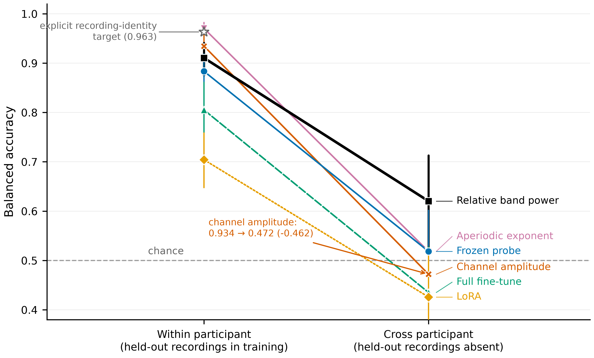<br><em>Controls under a change of split</em> |
| 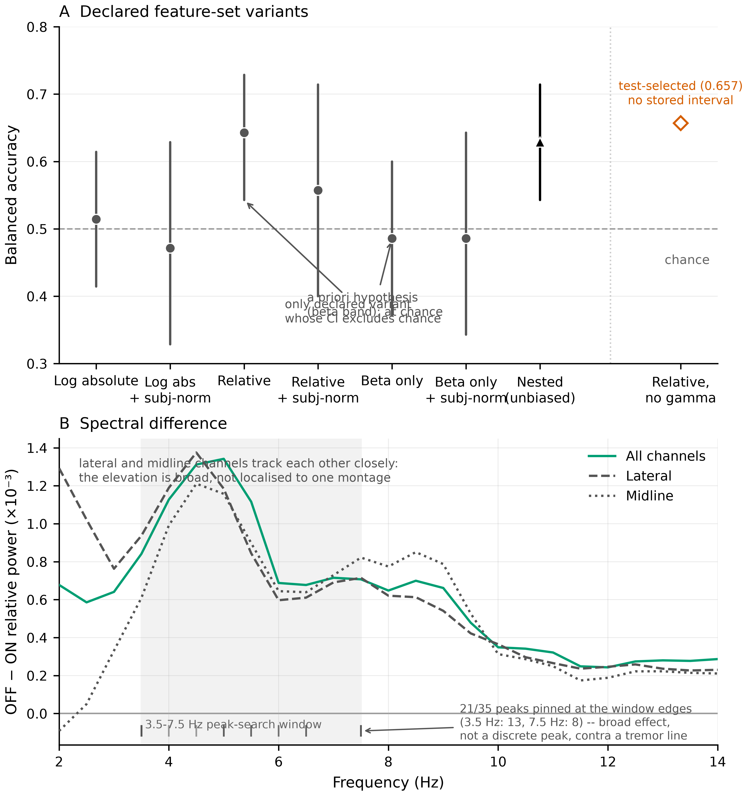<br><em>Classical spectral candidate</em> | 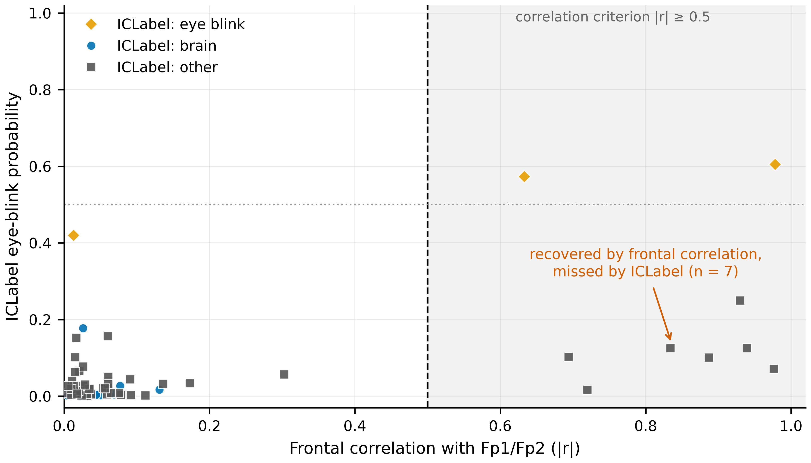<br><em>ICLabel failure cases</em> |

</details>

## Method

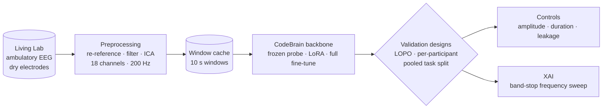

Recordings were analysed from 35 people with PD, each completing the same household tasks once ON and once OFF in a single visit to an apartment laboratory. CodeBrain was adapted three ways of increasing flexibility: a frozen probe, low-rank adaptation (LoRA) of 0.6% of the model, and full fine-tuning of all 15.2 million parameters. Estimates were checked against controls built from features that cannot carry brain activity, and thresholds were fixed before results were examined.

<table>
  <tr>
    <td width="50%">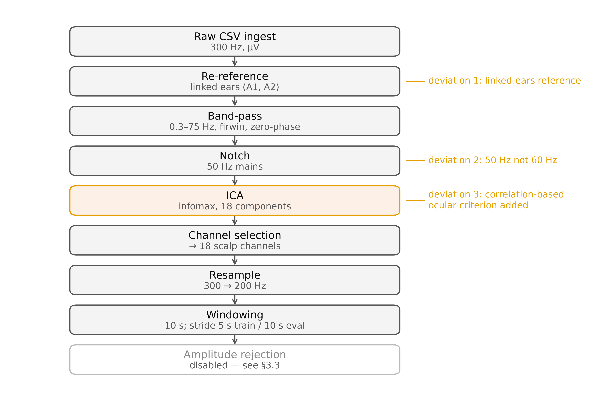</td>
    <td width="50%">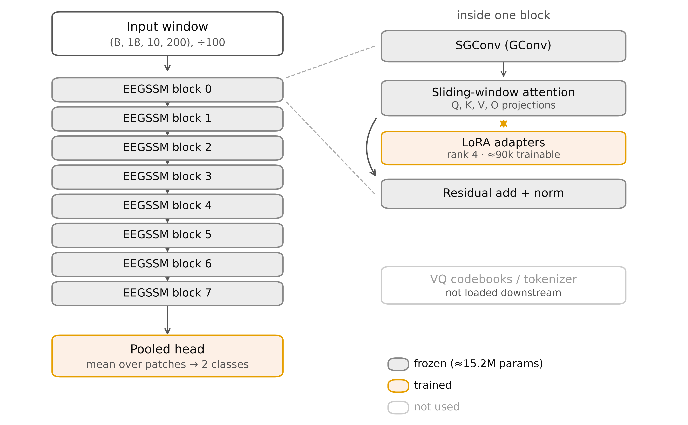</td>
  </tr>
  <tr>
    <td align="center"><em><b>Preprocessing pipeline</b>, with the three deviations from the reference pipeline marked</em></td>
    <td align="center"><em><b>CodeBrain backbone and adaptation</b>: what is frozen, what is trained</em></td>
  </tr>
</table>

<p align="center">
  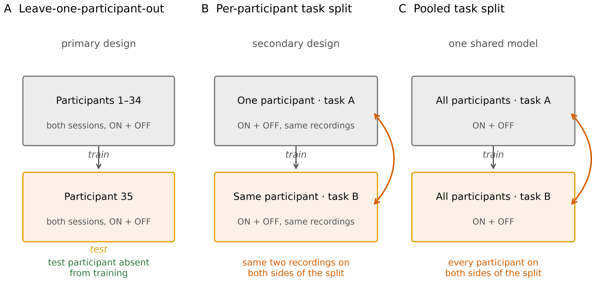
  <br>
  <em><b>Validation designs.</b> Only leave-one-participant-out keeps the test participant out of training entirely.</em>
</p>

## Repository layout

```
config/                 Preprocessing and QC configuration. Every pipeline parameter
                        lives here; no parameter is a literal in code.

src/livinglab_prep/     Stage 0. The preprocessing package: discovery, alignment,
                        re-referencing, filtering, ICA, windowing, serialisation, QC.

scripts/                Standalone entry points, grouped by purpose.
  preprocessing/          Cohort runs and the re-reference + ICA chain
  qc/                     Signal-quality audits and per-participant evidence
  ica_dev/                ICA and amplitude-rejection development sweeps
  audits/                 Dataset-integrity audits (file types, trigger channels)
  figures/                Evidence figures (spectra, spectrograms)

codebrain_finetune/     Stage 1+. Everything downstream of the window cache.
  src/codebrain_ft/       Fine-tuning library: data, model, LoRA, metrics, XAI
  src/                    Run scripts and staged experiment drivers
  config/                 Experiment configs (finetune, tasksplit, controls, transfer)
  results/                Per-experiment JSON/CSV plus runs_master_*.csv indexes
  logs/                   Console and per-run logs, script-generated run reports, figures

outputs/                Artifacts produced by scripts/ (audits, ICA sweeps, figures)
qc_signal_quality/      QC outputs for the cohort: PSD, aperiodic fits, impedance,
                        per-participant evidence and the summary report
logs/                   Run logs

figures/                One folder per dissertation figure, each holding the rendered
                        PNG/SVG, the make_figure.py that produced it, and its source data
dissertation/           The submitted dissertation
```

> [!TIP]
> The `runs_master_*.csv` files in `codebrain_finetune/results/` tie each run to its config, git SHA and metrics. They are the fastest way into the numbers.

### What is not in this repository, and why

- **The recordings.** Raw data lives on a read-only shared drive. It is secondary data belonging to the study that collected it, is never written to by this code, and is not redistributable.
- **The window cache.** Several GB of preprocessed windows. Regenerate with `scripts/preprocessing/run_cohort_continuous_csv.py`.
- **Model weights.** Pretrained CodeBrain weights come from Hugging Face ([`YjMajy/CodeBrain`](https://huggingface.co/YjMajy/CodeBrain)); per-run checkpoints are regenerated by the run scripts.
- **The upstream CodeBrain source.** Third-party code. Clone it from [`jingyingma01/CodeBrain`](https://github.com/jingyingma01/CodeBrain) into `codebrain_finetune/external/` before running anything that loads the backbone.

## Running things

Scripts assume the repository root as the working directory, so relative paths resolve.

```bash
pip install -r requirements.txt                       # Stage 0: preprocessing
pip install -r codebrain_finetune/requirements.txt    # Stage 1+: fine-tuning

python scripts/preprocessing/run_cohort_continuous_csv.py   # build the window cache
python scripts/qc/run_qc_signal_quality.py                  # QC audit over the cohort
python codebrain_finetune/src/run_pooled_tasksplit.py       # the main analysis
```

Regenerate every dissertation figure:

```bash
cd figures
for d in ch*/; do [ -f "$d/make_figure.py" ] && (cd "$d" && python make_figure.py); done
```

> [!NOTE]
> A GPU is required for anything that loads the backbone, and the batch size must be at least 2. The fine-tuning requirements pin a CUDA 12.8 PyTorch build; install it from the PyTorch CUDA 12.8 index rather than PyPI defaults.

## Licence

The code in this repository is released under the MIT Licence, in [`LICENSE`](LICENSE).

Three things in and around this repository are not covered by it:

- **The dissertation** in [`dissertation/`](dissertation/) is the author's own work and remains the author's copyright. It is published here to accompany the code, not for reuse.
- **CodeBrain** is third-party. Its pretrained weights are released under Apache-2.0; the GitHub source carries no licence, so contact its authors before reusing it. Neither is included here.
- **The recordings** are secondary data belonging to the study that collected them. They are not included, not redistributable, and were never written to by this code.

## Acknowledgements

Supervised by Dr Shlomi Haar. Recordings from the Living Lab study (Crook-Rumsey et al., 2023), UK Dementia Research Institute Care Research and Technology Centre, Imperial College London. CodeBrain by Ma et al. (2025).
